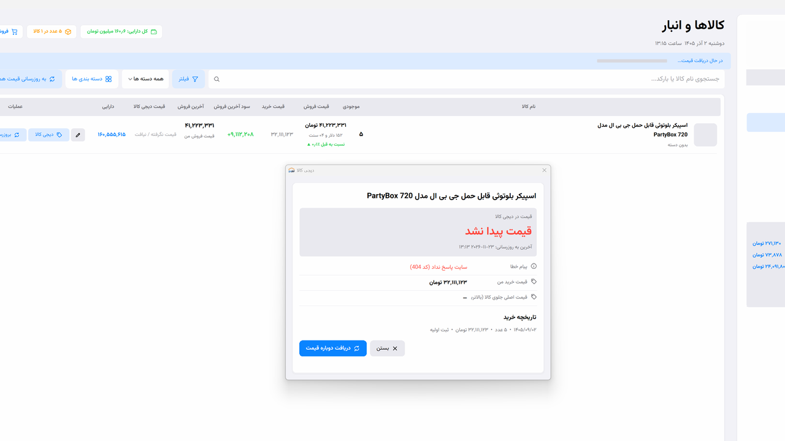

<div align="center">


# انبارمن

### نرم‌افزار حسابداری و انبارداری فروشگاه

مدیریت کالا، موجودی، فروش و فاکتور — همراه با قیمت دیجی‌کالا و نرخ ارز

<br/>

[](#)
[](#)
[](#)

<br/>



</div>

---

## انبارمن چیست؟

**انبارمن** یک برنامه دسکتاپ برای فروشگاه‌های کوچک و متوسط است.  
با آن می‌توانید کالا و موجودی را ثبت کنید، فروش بزنید، فاکتور بسازید و آمار فروش را ببینید.

قیمت کالا از **دیجی‌کالا** قابل دریافت است و نرخ **دلار، درهم و طلا** هم در برنامه نمایش داده می‌شود.

---

## ✨ امکانات

- 📦 **کالا و انبار:** ثبت کالا، موجودی، بارکد، دسته‌بندی و عکس
- 🧾 **فروش و فاکتور:** ثبت فروش، ساخت فاکتور و قابلیت چاپ
- 📊 **داشبورد:** خلاصه فروش امروز، هفته و ماه
- 🛒 **قیمت دیجی‌کالا:** به‌روزرسانی قیمت فروش از دیجی‌کالا
- 💵 **نرخ ارز:** دلار آمریکا، درهم امارات، طلای ۱۸ عیار
- 🏷️ **قیمت فروش:** مبلغ ثابت یا درصد سود روی خرید

---

## 📥 دانلود و اجرا

برای دانلود برنامه به بخش **[Releases (نسخه‌ها)](../../releases)** مراجعه کنید. در این بخش دو نسخه قرار دارد:

- **نسخه نصبی (Setup):** فایل `Anbarman-Setup.exe` را دانلود و نصب کنید.
- **نسخه پرتابل (Portable):** فایل `Anbarman-Portable.exe` را دانلود کنید و بدون نیاز به نصب، مستقیماً اجرا کنید.

---

## ساختار پروژه

```text
anbarman/
├── assets/          # لوگو، آیکون، فونت
├── theme.py         # رنگ و استایل
├── icons.py         # آیکون‌ها
├── prices.py        # دریافت قیمت دیجی‌کالا
├── database.py      # پایگاه داده SQLite
├── jalali.py        # تاریخ شمسی
└── ui.py            # رابط کاربری
anbarman.pyw         # نقطه اجرا
